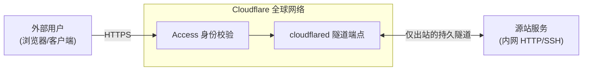
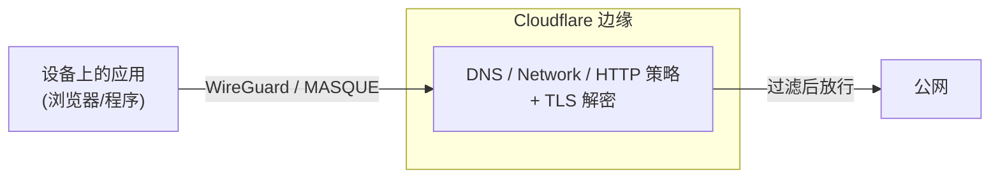
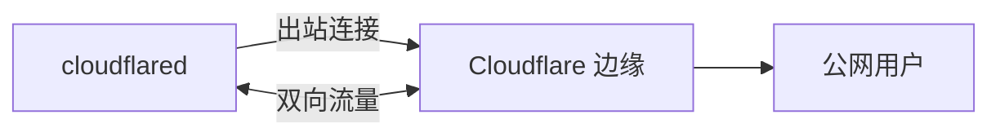

自建服务到一定规模后，问题会从"服务能不能跑起来"变成"谁能访问它、从哪访问、设备是否可信"。前者靠 Docker Compose 和反向代理就能解决，后者往往需要一整套身份认证、访问控制和流量审计。

Cloudflare Zero Trust（Cloudflare One）把这些能力打包在同一个平台里。第一次打开 [One Dashboard](https://one.dash.cloudflare.com/) 时，Networks、Access、Gateway、Settings 几组菜单会让人有点无从下手。它的结构很简单：**整个平台只有两条数据流**——入站和出站。把这两条线想清楚，面板里八成功能都能各归其位。

本文面向已经用过 Tailscale 一类组网工具、想弄清 Cloudflare 这套产品边界在哪的读者。

::github{repo="cloudflare/cloudflared"}

## 零信任到底在反对什么

传统网络安全模型是城堡与护城河：内网可信，边界设防，只要进了内网就默认是"自己人"。这个假设在办公室加机房的年代成立，现在则很难维持——用户在家里、设备在路上、应用在云上，所谓边界早就碎了。更麻烦的是，攻击者一旦进来，横向移动几乎没有阻力。

零信任反转了这个默认值：**不信任任何请求，无论它来自内网还是公网**。每一次访问都要重新回答三个问题：你是谁、你的设备是否健康、你要访问什么。授权跟着请求走，而不是跟着网线走。

Cloudflare 把这类能力归到 SASE（Secure Access Service Edge）这个概念下，用统一的控制平面在它的全球网络上替代"硬件边界加一堆点状安全设备"的拼凑，把身份、网络和安全策略放进了同一个地方。

## 产品分组

控制面板里的功能，本质是同一个平台下的一组产品。按职责分组后，它们和两条数据流的对应关系就清楚了：

| 分组 | 产品 | 一句话职责 | 数据流 |
|---|---|---|---|
| 访问控制 | **Access**（ZTNA） | 对每个访问应用的请求做身份认证与授权，默认拒绝 | 入站 |
| | **Cloudflare Tunnel** | 通过 `cloudflared` 建立仅出站连接，无公网 IP 也能接入资源 | 入站 |
| | **Cloudflare One Client**（原 WARP） | 装在设备上，把流量私密送到 Cloudflare，并上报设备健康状态 | 出站 |
| 流量过滤 | **Secure Web Gateway**（Gateway） | 检查并过滤 DNS、网络、HTTP 与出口流量 | 出站 |
| | **Browser Isolation**（RBI） | 浏览器代码在云端执行，本地只收渲染结果 | 出站 |
| | **Egress** | 给组织分配固定的出口 IP | 出站 |
| 数据与邮件 | **CASB** | 保护 SaaS 应用和云环境里的静态数据，发现影子 IT | — |
| | **DLP** | 扫描 Web 流量与 SaaS 应用里的敏感数据 | 出站 + 数据 |
| | **Email Security** | 邮件入站防护与策略处置 | — |
| 可观测 | **DEX** | 监控设备、网络、应用性能 | — |

其中真正需要先掌握的只有三个：**Tunnel、Access、Gateway**（含 WARP 客户端）。CASB、DLP、RBI、Email Security、DEX 偏企业向，理解了前三个之后再看它们并不难。

## 免费版够不够用

Cloudflare Zero Trust 提供 Forever Free 计划，最高 50 个 seat，\$0。付费版从按量计费起步，大约 \$7/用户/月。对个人自建或小团队来说，免费版通常绰绰有余。

关键配额如下，具体数字以官方 [Account limits](https://developers.cloudflare.com/cloudflare-one/account-limits/) 页为准：

| 资源 | 免费/默认上限 |
|---|---|
| 用户 seat | 50 |
| WARP 客户端用量 | 50 用户内不限 |
| Gateway 策略（DNS/Network/HTTP/Egress/Resolver 各计） | 各 500 条 |
| Cloudflare Tunnel | 每账户 1000 条；单隧道活跃副本 25 |
| 日志留存 | 24 小时（付费版 30 天） |
| DNS locations | 250 |
| 每月验证次数 | 约 100 万 |

**发布应用走 Tunnel 本身不收费**，也不需要 Access 套餐。只有当你给应用套上"登录才放行"的 Access 策略时，才会占用 seat，而免费版给 50 个。

## 两条数据流

### 入站：把服务暴露出去

方向是 **外部用户 → Cloudflare 边缘 → Tunnel → 源站**。



源站不开放任何入站端口，也不需要公网 IP。`cloudflared` 守护进程从源站主动向 Cloudflare 拨出连接，流量在隧道里双向流动。Access 位于整条链路的最前面，认证不通过，请求根本到不了源站。

### 出站：把设备保护起来

方向是 **设备上的应用 → WARP 客户端 → Cloudflare 边缘 → 公网**。



设备安装 Cloudflare One Client 后，流量被加密送到 Cloudflare，由 Gateway 按 DNS、网络、HTTP 三层策略过滤。同时，用户身份和设备健康状态也一并上报，策略因此可以按人、按设备做判断。

### 菜单与数据流的对应关系

| 菜单分组 | 内容 | 角色 |
|---|---|---|
| **Networks → Tunnels** | cloudflared 隧道配置 | 入站：把源站接入 Cloudflare |
| **Access → Applications** | 要保护的每个应用 | 入站：Access 的挂载对象 |
| **Access → Policies** | 谁能访问哪个应用 | 入站：判定规则 |
| **Access → Service Auth** | Service Tokens、mTLS | 入站：非人类身份 |
| **Access → App Launcher** | 企业门户页 | 入站：统一入口 |
| **Gateway → Firewall / DNS / HTTP** | 出站过滤策略 | 出站：三层过滤 |
| **Gateway → Egress / Resolver** | 出口 IP、私有 DNS 解析 | 出站 |
| **Gateway → Locations** | DNS 接入点（DNS-only 部署用） | 出站：DoH 方式 |
| **Settings → Authentication** | IdP 连接、登录方式、会话时长 | 全局：身份层 |
| **Settings → Devices** | 设备注册策略、WARP profile、Split Tunnels | 出站：设备入网 |
| **Settings → WARP Client** | 客户端部署、模式、根证书 | 出站：客户端 |
| **My Team → Devices / Users** | 已注册设备、seat 占用 | 全局：清点 |

菜单名称会随 Dashboard 改版变化；比具体路径更稳定的是菜单项对应的数据流。

## Access：应用访问控制

Access 的官方定义是：通过你配置的策略决定谁能触达应用。它默认**拒绝一切**，只有显式命中 Allow 策略的请求才放行。

### 一次请求的判定流程

1. **认证**：请求携带身份凭证——IdP 校验后的邮箱或组、客户端证书、Service Token 头等。
2. **授权**：按固定优先级评估策略。
3. **放行或阻断**：命中 Allow，流量进入隧道到达源站；命中 Block，直接拒绝。命中即停，后面的策略无法覆盖。

身份属性（你是谁）在登录时校验一次；非身份属性（IP、国家、设备状态等）在会话期间持续轮询，属性变化可以实时踢掉或放行会话。这一点是 Access 和"登录一次就永久有效"的传统网关最大的区别。

### 策略的四个构件

一条 Access 策略由四块拼成，这也是最容易理解错的地方：

| 构件 | 作用 | 语义 |
|---|---|---|
| **Action** | 策略最终做什么 | `Allow`、`Block`、`Bypass`、`Service Auth` |
| **Include**（至少一条） | 定义初始合格池 | **OR**：命中任一即进入候选 |
| **Exclude** | 排除 | **NOT**：命中即拒绝 |
| **Require** | 必须全部满足 | **AND**：全中才放行 |

三组规则之间是 AND 关系：请求要命中 Include、不命中 Exclude、并满足全部 Require，这条策略才算匹配。

优先级方面，`Bypass` 和 `Service Auth` 策略先被评估；随后按从上到下的顺序评估 `Block` 和 `Allow`。请求一旦命中 Allow 或 Block，评估立即停止。

> ⚠️ 常见坑：同一个 Require 里的多个值默认是 **AND**。比如 Require "邮箱属于 A 组 AND 邮箱属于 B 组"，结果往往是谁都进不去。需要"或"逻辑时，用 rule group 把它们转成 OR。

每个 Selector 的来源不同：身份类属性来自 IdP，非身份类属性（IP、国家、设备状态、登录方式等）由 Cloudflare 边缘实时判定。

### 身份提供商

Access 自己不存密码。它把"验证你是谁"外包给接入的 Identity Provider，比如 Google、GitHub、Microsoft Entra ID、Okta，或任何 SAML/OIDC 提供方。流程只有三步：

1. 在 **Settings → Authentication → Login methods** 添加 IdP。
2. 在 Access 策略里使用"邮箱、组、登录方式"等 Selector，值由 IdP 的校验结果提供。
3. 用户访问受保护应用时被重定向到 IdP 登录，通过后回到 Cloudflare，拿到一个短期会话。

个人使用 GitHub 或 Google 登录就够了；想统一管理账号，也可以自建 Authentik、Keycloak 这类 OIDC IdP。

### 机器身份：Service Tokens 与 mTLS

Access 也支持机器对机器的认证，免去交互式登录：

- **Service Tokens**：自动化系统使用的凭据，请求带上 `CF-Access-Client-Id` 和 `CF-Access-Client-Secret` 头即可。**不占用 seat**，需要配合 `Service Auth` 动作使用。
- **Mutual TLS**：要求客户端出示受信任的 TLS 客户端证书，通过 `Service Auth` 动作加 `Valid Certificate` / `Common Name` Selector 实现，适合 API、脚本和设备对设备。

### OTP 的边界

Access 支持多种登录方式：IdP、一次性 PIN（OTP）、服务令牌等。OTP 是给没有 IdP 的零散用户准备的——输入邮箱，收到验证码，通过。

> ⚠️ 坑：如果 Allow 策略写成 `Include: Login Methods = One-time PIN` 并且对所有有效邮箱开放，等于对任何能收信的人放行。OTP 只验证"邮箱可达"，不验证"邮箱是你的"。只开 OTP 时，策略还需要叠加 IP 范围或设备状态等条件。

### 会话与设备 posture

- **Session duration** 决定登录后会话保持多久。身份属性只在登录时校验，但 IP、设备状态这类非身份属性会持续重评。
- **Device Posture** 是接入 WARP 的设备上报的健康状态，包括系统版本、磁盘是否加密、是否安装了指定软件等。Access 策略可以用它要求"只有合规设备才能访问"。

设备 posture 是零信任里"信任设备"的那一环。没有它，Access 只能回答"你是谁"，回答不了"你从什么设备来"。

## Tunnel：不开放入站端口地把服务暴露出去

### 架构

Cloudflare Tunnel 的核心是 `cloudflared`，一个跑在源站里的轻量守护进程。它主动向 Cloudflare 全球网络发起**出站**连接，而不是等待外部连入。

隧道本身是一个用 UUID 标识的持久化对象，代表源站与 Cloudflare 之间的逻辑链路。同一条隧道可以运行多个 `cloudflared` 副本，每个副本把流量送往最近的 Cloudflare 数据中心。



多个副本带来高可用和就近接入：某个副本挂掉，流量自动转到其他副本。

### Public Hostname 与 Private Network

这是控制面板里最容易混淆的一对概念。两者都走 Tunnel，但受众和数据流完全不同：

| 维度 | Public Hostname | Private Network |
|---|---|---|
| 发布什么 | 公网应用/API/Web 服务 | 私有网段（如 `10.0.0.0/8`） |
| 谁访问 | 任何公网用户（通常叠加 Access） | 只有安装了 WARP 并注册到组织的设备 |
| 访问方式 | 浏览器访问公网域名 | 设备直接访问内网 IP/域名，像 VPN |
| 是否暴露到公网 | 是，DNS 可解析 | 否，不产生公网入口 |
| 典型用途 | 把自建服务发布成网站 | 替代 VPN 的远程办公访问 |
| 类比 | frp / 公网反向代理 | Tailscale 的 subnet routing |

**Public Hostname** 把域名 DNS 记录指到隧道，通常是 CNAME 到 `<隧道UUID>.cfargotunnel.com`。隧道再把请求转发给源站地址 `protocol://host:port`，例如 `https://localhost:8080`。

**Private Network** 则是给隧道配置一条路由，比如 `10.0.0.0/8 → 隧道`。组织内的 WARP 设备通过客户端路由表访问这些网段，源站 IP 完全不暴露在公网。

### 最简配置

以 Public Hostname 为例，在源站执行：

```bash
cloudflared tunnel login
cloudflared tunnel create myapp
cloudflared tunnel route dns myapp app.example.com
```

`route dns` 会自动创建指向 `<UUID>.cfargotunnel.com` 的 CNAME。然后写 `config.yml`：

```yaml
tunnel: <隧道UUID>
credentials-file: /root/.cloudflared/<UUID>.json
ingress:
  - hostname: app.example.com
    service: http://localhost:8080
  - service: http_status:404
```

最后一条兜底规则必须存在，否则 `cloudflared` 会拒绝启动。启动命令是 `cloudflared tunnel run myapp`。

高可用方面，同一条隧道可以在同一台或多台机器上跑多个副本，Cloudflare 会自动做负载均衡和故障转移。单隧道的活跃副本上限是 25 个。

### 为什么它比端口转发安全

核心差异是：**源站没有入站监听器**。

- 不需要公网 IP，不需要开放任何入站端口，暴露面归零。
- 利用"大多数防火墙默认放行出站"的既成事实，让 `cloudflared` 从内向外拨号。
- 你可以把入站流量全部封死，从网络层面杜绝"绕过 Cloudflare 直连源站"的攻击。
- 源站身份由隧道连接器凭证验证。

还有一个附带的后果：因为流量已经走 TLS 隧道、源站被 Cloudflare 隐藏，常规的 Authenticated Origin Pulls（TLS 客户端证书认证）对走隧道的域名不起作用，信任链改由隧道连接器凭证承载。

## WARP：把设备接进组织

### 两种接入方式

Cloudflare One Client 通过两种方式把设备流量送到 Cloudflare：

- **代理隧道**：用 WireGuard 或 MASQUE 加密并路由互联网与私有网络流量，对应 Gateway 的 Network/HTTP 过滤。
- **DNS 代理**：通过 DNS-over-HTTPS 把查询送到 Cloudflare，对应 Gateway 的 DNS 过滤。

客户端原名 WARP，现在官方名称是 Cloudflare One Client，由 GUI、守护进程、`warp-cli` 命令行和 `warp-diag` 诊断工具组成。

### 五种运行模式

在 **Settings → WARP Client** 里可以按设备配置 profile，决定这台设备的流量怎么走。旧文档里的 "WARP mode / Gateway with WARP / Gateway with DoH" 是过时叫法，现在官方使用五种模式：

| 模式 | 处理什么流量 | DNS 归谁 | 可用过滤 | 典型场景 |
|---|---|---|---|---|
| **Traffic and DNS**（默认） | 全部端口/协议 + DNS | Cloudflare | DNS + Network + HTTP | 完整零信任覆盖 |
| **DNS only** | 仅 DNS 查询 | Cloudflare | 仅 DNS | 只做恶意域名拦截 |
| **Traffic only** | 全部流量，DNS 留本机 | 操作系统 | Network + HTTP | 保留现有 DNS 过滤软件 |
| **Local proxy** | 仅显式指向 `127.0.0.1:40000` 的流量 | 本机 | 仅 HTTP | 只过滤指定应用 |
| **Posture only** | 不路由流量，只上报设备健康 | 本机 | 仅 posture 检查 | 只做设备合规门禁 |

能力矩阵：

| 模式 | DNS 策略 | Network 策略 | HTTP 策略 |
|---|:---:|:---:|:---:|
| Traffic and DNS | ✅ | ✅ | ✅ |
| DNS only | ✅ | ❌ | ❌ |
| Traffic only | ❌ | ✅ | ✅ |
| Local proxy | ❌ | ❌ | ✅ |
| Posture only | ❌ | ❌ | ❌ |

两个细节：**Traffic only 会禁用依赖客户端 DNS 解析的功能**（基于域名的 Split Tunnels、Local Domain Fallback），并且只支持 Windows、Linux、macOS；**Local proxy 必须使用 MASQUE 协议**，WireGuard 不支持。

### 设备注册

设备第一次用客户端完成认证时，系统会自动创建一条 device registration，不需要手动录入。能否注册由 Device Enrollment Policies 控制，用户必须先通过 IdP 验证身份。

一个物理设备可以同时存在多条注册，比如多人共用一台笔记本、各自用自己的凭据登录。删掉一条注册不影响同设备的其他注册；删掉设备记录则会连带删除它的全部注册。

**Seat 是计费单位**。一个用户无论注册多少台设备，都只占一个 seat；服务令牌不占 seat。删设备或删注册**不会释放 seat**，要在 Users 页面移除用户才会释放。

> ⚠️ "删除不等于永久"：只要用户还能重新认证，被删掉的注册会自动重建。想永久移除访问，必须同时从 enrollment policy 或 IdP 移除该用户，并撤销服务令牌。

### Split Tunnels 与 Local Domain Fallback

**Split Tunnels** 决定哪些流量走 WARP/Gateway、哪些直连。官方明确它只影响 IP 流量，DNS 查询仍然由 Gateway 解析并受 DNS 策略约束，除非域名进入了 Local Domain Fallback。

- **Exclude 模式（默认）**：除指定条目外，所有流量都进入 Gateway。
- **Include 模式**：只有指定条目的流量进入 Gateway，其余绕过，不受 Network/HTTP 策略过滤。

Include 模式适合"只把特定私有网段的访问走隧道"。条目可以写 IP/CIDR（推荐，解析快），也可以写域名（支持通配符）。但域名解析出的 IP 可能每天变化，也可能误伤同一 IP 上的其他服务；桌面端会动态加路由，移动端只在建立隧道时应用一次。

> ⚠️ 用 Include 模式时，必须手动把 Cloudflare 相关域名加进白名单：IdP、`<team>.cloudflareaccess.com`、受保护应用、Browser Isolation 的 `edge.browser.run`、拦截页 IP。漏掉任何一个，设备 posture、会话时长这类功能都会莫名失效。

**Local Domain Fallback** 解决另一个问题：当域名没有公共 DNS 记录时（比如内网域名 `nas.lan`），需要让私有 DNS 服务器来解析。访问这类域名时按 LDF 配置解析，Split Tunnels 再根据解析结果决定是否把返回的 IP 纳入隧道。

这和 Tailscale 的 MagicDNS 加 split DNS 是同一个问题的两种解法。Tailscale 用 MagicDNS 解析内部域名，Cloudflare 用 Local Domain Fallback，遇到的问题也类似：配置看似正确，解析结果却来自错误的地方。

### 1.1.1.1 与 Cloudflare One Client

这两个经常被混为一谈：

- **1.1.1.1 App** 是消费级产品，提供公共 DNS-over-HTTPS 和 WARP 加密，不接入任何组织策略。
- **Cloudflare One Client** 是组织级客户端，受 Zero Trust 的 enrollment、策略和设备管理约束。

同一份 WARP 代码，连接模式和组织归属不同。**1.1.1.1 是给个人的，One Client 是给组织的**。Dashboard 里管理的是后者。

## Gateway：出站流量过滤

### 三层策略

Gateway 就是 Secure Web Gateway，内建于 Cloudflare One。它把检查点放到离用户最近的边缘节点，恢复对出站流量的可见性与控制。策略更新全球同步最多 60 秒。

三层过滤对应传统防火墙概念的迁移：

| 策略层 | 过滤对象 | 匹配时机 | 传统对应 |
|---|---|---|---|
| **DNS** | 域名（每个 DNS 查询） | 连接建立前，页面尚未加载 | DNS 过滤 |
| **Network** | IP、端口、协议、SNI | 连接层（L4），TCP/UDP/GRE | 有状态防火墙 |
| **HTTP** | URL、请求头、上传下载内容 | 应用层（L7） | 应用防火墙，需 TLS 解密 |

选型按匹配对象来定：

- 按 URL 阻止网站 → HTTP 策略
- 按域名阻止 → DNS 策略
- 阻止 SSH/RDP 端口 → Network 策略
- 防恶意软件 → DNS + HTTP 组合，DNS 拦已知恶意域名，HTTP 捕获放行流量里的威胁

策略可以按用户邮箱、组、设备磁盘加密状态等上下文判断，这是 SWG 区别于传统防火墙的地方。

### TLS 解密的原理与代价

HTTP 策略要看内容，就得先解密出站 HTTPS：

1. 设备安装 Cloudflare 根证书，建立信任链。
2. Gateway 作为转发代理解密流量，检查明文，再重新加密转发给目标服务器；响应回程同样被检查。

代价是：**必须在用户设备上安装根证书**，这是部署 HTTP 策略的前提，也是很多组织抵触的点。没装证书的设备无法做 L7 检查。

好在 Network 策略不需要解密，匹配加密连接起始时的 SNI 就能获得部分可见性。所以"先上 DNS 和 Network 策略，HTTP 策略按需开启"是更务实的推进顺序。

### 四种接入方式

设备的出站流量可以通过四种方式接入 Gateway，支持的能力不同：

| 接入方式 | DNS | Network | HTTP | 场景 |
|---|:---:|:---:|:---:|---|
| **Cloudflare One Client（WARP）** | ✅ | ✅ | ✅ | 漫游用户、托管设备；覆盖最广，能提供身份与设备上下文 |
| **DNS resolver（DoH / DNS location）** | ✅ | ❌ | ❌ | 非托管设备、整个网络；改路由器 DNS 即可，但只执行 DNS 策略 |
| **Proxy endpoint（PAC 文件）** | ❌ | ❌ | ✅（仅浏览器） | 不装客户端，只限浏览器流量 |
| **Network tunnel（IPsec/GRE via Magic WAN）** | ✅ | ✅ | ✅ | 分支机构、数据中心站点级接入 |

官方建议每台设备优先用 WARP，也可以组合多种方式，比如远程员工用 WARP、分支机构用隧道。

### Egress、Resolver 与 Packet Filtering

Gateway 里还有几个独立功能：

- **Egress policies**：给组织分配固定出口 IP，出站流量统一从指定 IP 出去，方便第三方白名单。
- **Resolver policies**：把 DNS 查询路由到自定义 DNS 服务器，比如公司的内部私有域名解析。
- **Packet filtering**：按源 IP 或协议丢弃数据包，在所有策略之前执行，不需要用户上下文，属于纯网络层预过滤。

## 三个典型落地场景

### 场景 A：Tunnel + Access 暴露 Web 服务

目标是把一个自建服务发布成 `app.example.com`，公网可访问，但必须登录。

1. 把域名接入 Cloudflare，DNS 托管到 Cloudflare。
2. 建隧道：`cloudflared tunnel create`，`route dns` 建 CNAME，ingress 指向 `http://localhost:8080`。此时服务已经可以公网访问。
3. 添加 IdP：Settings → Authentication → Login methods，接入 GitHub 或 Google。
4. 建 Access 应用：Access → Applications → Add → Self-hosted，填入 `app.example.com`。
5. 建策略：`Action = Allow`，`Include = Email 结尾 @你的域名`。
6. 可选加固：加 Device Posture Require、自定义登录页域名、WAF 规则。

与 Tailscale 的差别在于：Tailscale 是"接入我网络的人可以访问内网 IP"，而 Access 是"公网域名谁都能敲，但敲了之后要登录"，而且鉴权粒度是单个应用。

### 场景 B：Private Network 远程访问内网

目标是让外部设备像在局域网里一样访问整个网段，用来替代 VPN 或补充现有组网。

1. 建隧道，配置 Private Network 路由，例如 `10.0.0.0/8 → 隧道`。
2. 在外部设备安装 Cloudflare One Client，通过组织 enrollment 完成注册。
3. 验证设备能直接访问 `10.0.x.x` 的机器。
4. 用 Access 策略或 Gateway Network 策略限制哪些用户、哪些设备能访问该网段。

这是 Cloudflare 版的"subnet router + 客户端"。区别在于它是中心辐射模型：设备 → Cloudflare 边缘 → 内网；Tailscale 则是端到端 mesh，尽量点对点直连。多人异地共享一个内网时体验接近，但延迟特征和隐私模型不同。

### 场景 C：设备出站过滤

目标是限制某台设备访问恶意站点或特定类别网站。

1. 注册设备。
2. 建 DNS 策略：Gateway → Firewall Policies → DNS，`Action = Block`，`Content Category = Security Threats`。官方建议初始策略就拦住所有安全威胁类别。
3. 需要按 URL 精确拦截或做 DLP 时，先在 WARP profile 开启 TLS 解密并下发根证书，再建 HTTP 策略。
4. 访问被拦域名应命中拦截页，Dashboard → Logs 里能看到策略命中记录。

## 和 Tailscale 怎么选

如果已经熟悉 Tailscale，可以借它的心智模型来对照：

| 维度 | Tailscale | Cloudflare Zero Trust |
|---|---|---|
| 连接模型 | 端到端 mesh，点对点打洞 | 中心辐射，流量都过 Cloudflare 边缘 |
| 内核协议 | WireGuard | WireGuard（WARP）/ MASQUE + 自有隧道 |
| 暴露服务 | Funnel / 内网 IP | Tunnel Public Hostname / Private Network |
| 访问控制 | ACL，基于标签和用户 | Access 策略，粒度到单个应用和请求 |
| 设备入网 | 登录或邀请即加入 tailnet | Enrollment + IdP 校验 + enrollment policy |
| 出站过滤 | 基本没有 | Gateway 三层策略 |
| 私有 DNS | MagicDNS + split DNS | Local Domain Fallback + Resolver policies |
| 免费额度 | 3 用户 100 设备 | 50 seats，WARP 不限量 |
| 数据隐私 | 点对点，流量不经过第三方 | 所有流量必经 Cloudflare 边缘，可解密检查 |
| 部署形态 | 纯 overlay 组网工具 | 完整 SASE 平台 |

重叠区是远程访问内网、暴露服务、设备与用户管理，取舍核心是 **mesh 直连还是中心辐射**。Tailscale 延迟低、适合点对点大流量，但能力止步于组网；Cloudflare 多一跳，换来统一的访问控制和出站安全策略。

互补区也很明显：Tailscale 负责高性能内网 mesh，Cloudflare 负责公网侧服务的认证暴露和设备出站过滤，两者可以共存。真正需要二选一的，通常只是"远程访问内网"这一块。

Tailscale 是"一张不信任别人、但信任自己设备的网"；Cloudflare Zero Trust 是"每个请求都重新问你一遍是谁、从哪来、设备健不健康"。

## 常见误区

1. **误区：Public Hostname 和 Private Network 是一回事。**

    正解：前者公网可访问，用于 Web 发布；后者只给注册 WARP 的设备，用于内网访问。

2. **误区：还在用 "WARP 模式 / Gateway with DoH" 这些旧名词。**

    正解：官方现用 Traffic and DNS、DNS only、Traffic only、Local proxy、Posture only。

3. **误区：1.1.1.1 App 就是 WARP。**

    正解：1.1.1.1 是消费级 App；组织用的 Cloudflare One Client 受策略管理。

4. **误区：Require 里加多个条件等于满足其一。**

    正解：默认是 AND，全中才放行；要 OR 得用 rule group。

5. **误区：Bypass 策略方便就先放着。**

    正解：Bypass 直接跳过 Access 全部检查，等于裸奔。

6. **误区：删设备或注册就释放了配额。**

    正解：seat 要在 Users 页面移除用户才释放；删掉的注册只要还能认证就会重建。

7. **误区：OTP 登录很安全。**

    正解：OTP 只证明邮箱可达，不证明邮箱属于你；对所有邮箱开放等于全放行。

8. **误区：装了 WARP 就自动全流量过滤。**

    正解：过滤范围取决于客户端模式和 Split Tunnels，只有 Traffic and DNS 是全开。

9. **误区：HTTP 策略开箱即用。**

    正解：需要先装 Cloudflare 根证书做 TLS 解密，否则只能匹配 SNI。

10. **误区：Access 是 VPN 的替代品。**

    正解：Access 是应用层逐个鉴权，不建虚拟内网；Private Network + WARP 才接近 VPN。

## 参考资料

- [Cloudflare One 文档首页](https://developers.cloudflare.com/cloudflare-one/)
- [账户限制](https://developers.cloudflare.com/cloudflare-one/account-limits/)
- [Cloudflare Tunnel 概念](https://developers.cloudflare.com/cloudflare-one/connections/connect-networks/)
- [Tunnel 发布应用](https://developers.cloudflare.com/cloudflare-one/connections/connect-networks/routing-to-tunnel/)
- [Access policies](https://developers.cloudflare.com/cloudflare-one/policies/access/)
- [Gateway（SWG）概念](https://developers.cloudflare.com/cloudflare-one/policies/gateway/)
- [Cloudflare One Client](https://developers.cloudflare.com/cloudflare-one/connections/connect-devices/warp/)
- [客户端模式](https://developers.cloudflare.com/cloudflare-one/connections/connect-devices/warp/configure-warp/warp-modes/)
- [Split Tunnels](https://developers.cloudflare.com/cloudflare-one/connections/connect-devices/warp/configure-warp/route-traffic/split-tunnels/)
- [设备注册](https://developers.cloudflare.com/cloudflare-one/connections/connect-devices/device-registration/)

Cloudflare Zero Trust 的复杂度不在单个功能，而在产品之间的边界。Tunnel 负责"怎么连进来"，Access 负责"谁可以进来"，WARP 和 Gateway 负责"设备出去时经过什么"。把这四件事分开看，控制面板就不再是一团需要死记的菜单。
