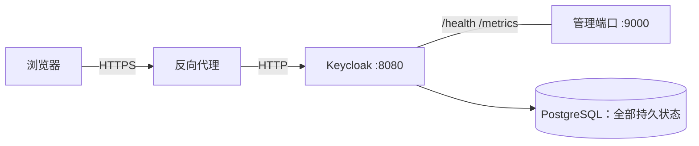

自建服务多了以后，账号体系会先于硬件出问题：每个服务一套用户名密码，离职或换设备时没人说得清哪个账号还在用；想给某个服务开管理员权限，只能挨个改配置。统一认证就是把「你是谁」交给一个服务，其余服务只负责「你能做什么」。

Keycloak 是自建环境里用得最久的一个选择。它把 OIDC、SAML、用户目录、组和角色、Passkey 都放在一个进程里，下游服务只要能说 OIDC 就能接进来。这篇从零搭一套能长期跑的实例：数据库、生产模式启动、反向代理、健康检查、备份与升级。第二篇讲怎么把服务接进来。

::github{repo="keycloak/keycloak"}

## 为什么是 Keycloak

同类的选择主要有三类。Authentik 的界面更现代，配置流程更顺，适合以「开箱即用」为第一诉求的人；Authelia 更轻，擅长给没有账号体系的反向代理加一层门禁，但它不是完整的身份提供方；各服务自带的账号体系最省事，代价是永远无法统一。

Keycloak 的优势在协议和生态：OIDC 与 SAML 都支持，绝大多数自建服务都能找到现成的接入方式；组映射（groups claim）做得完整，可以让一套组同时驱动 Grafana 的管理员、GitLab 的 admin 和其他服务的权限；Passkey 是一等公民，不需要额外插件。它的代价也很明确：JVM 应用，内存占用比 Authelia 高一个量级。实测这套空载实例（26.8.1，7.4 GiB 可见内存、堆上限按 50% 计算）常驻约 850 MiB，其中大部分是 JVM 堆和元空间。如果你的机器只有 1 GiB 空闲内存，先别选它；如果能给 1.5–2 GiB，它完全值得。

单机 homelab 值不值得上 Keycloak？判断标准是：下游服务超过三个，或者你已经厌倦了在每个服务里单独管密码，就值得。只有一个服务时，没必要为了 SSO 多养一个 JVM。

## 部署形态：实例与数据库分离

Keycloak 自己几乎不存状态。用户、realm、client、组、Passkey 凭据、会话索引全部在 PostgreSQL 里，容器本身可以随时删掉重建。这个设计决定了后面所有运维动作的形态：



由此得到三条结论。备份要备数据库，不是备容器；升级出问题时，回滚要落到数据库 schema，而不只是换回旧镜像；重建容器不会清掉任何配置，所以「重启一下」永远不是修复配置错误的手段。很多人第一次用 Keycloak 时会误以为删掉容器等于重置，实际删完后数据原样还在。

## 用 Compose 启动

下面这份 compose 是实际跑通的版本，PostgreSQL 16 + Keycloak 26.8.1。为了让构建结果可复现，Keycloak 用多阶段 Dockerfile 先执行 `kc.sh build`，运行时再加 `--optimized`，避免每次启动都做一次 augmentation。

```yaml
name: kc-demo

services:
  postgres:
    image: postgres:16-alpine
    container_name: kc-demo-postgres
    environment:
      POSTGRES_DB: keycloak
      POSTGRES_USER: keycloak
      POSTGRES_PASSWORD: change-me-please
    volumes:
      - pgdata:/var/lib/postgresql/data
    healthcheck:
      test: ["CMD-SHELL", "pg_isready -U keycloak -d keycloak"]
      interval: 5s
      timeout: 3s
      retries: 20
    restart: unless-stopped

  keycloak:
    build: .
    image: kc-demo/keycloak:26.8.1
    container_name: kc-demo-keycloak
    command: ["start", "--optimized"]
    environment:
      KC_HOSTNAME: http://localhost:18080
      KC_HTTP_ENABLED: "true"
      KC_PROXY_HEADERS: xforwarded
      KC_DB: postgres
      KC_DB_URL: jdbc:postgresql://postgres:5432/keycloak
      KC_DB_USERNAME: keycloak
      KC_DB_PASSWORD: change-me-please
      KC_HEALTH_ENABLED: "true"
      KC_METRICS_ENABLED: "true"
      KC_FEATURES: passkeys
      KC_BOOTSTRAP_ADMIN_USERNAME: admin
      KC_BOOTSTRAP_ADMIN_PASSWORD: change-me-please
      JAVA_OPTS_KC_HEAP: "-XX:MaxRAMPercentage=50 -XX:InitialRAMPercentage=30"
    ports:
      - "18080:8080"
      - "19001:9000"
    depends_on:
      postgres:
        condition: service_healthy
    restart: unless-stopped

volumes:
  pgdata:
```

```dockerfile
FROM quay.io/keycloak/keycloak:26.8.1 AS builder

ENV KC_DB=postgres
ENV KC_HEALTH_ENABLED=true
ENV KC_METRICS_ENABLED=true
ENV KC_FEATURES=passkeys

RUN /opt/keycloak/bin/kc.sh build

FROM quay.io/keycloak/keycloak:26.8.1
COPY --from=builder /opt/keycloak/ /opt/keycloak/
ENTRYPOINT ["/opt/keycloak/bin/kc.sh"]
```

几个容易抄错的点：

- **`--optimized` 必须配合构建阶段。** 直接拿官方镜像执行 `start --optimized`，第一次启动会报 `The '--optimized' flag was used for first ever server start`（实测报错原话如此）。要么用上面的 Dockerfile，要么去掉 `--optimized`，让容器自己构建。
- **`depends_on` 的 `condition: service_healthy` 不能省。** 只写 `depends_on: [postgres]` 只保证容器启动顺序，不保证 PostgreSQL 已经能接受连接。空库首次启动时 Keycloak 要跑 Liquibase 建表，数据库没就绪会直接退出，然后陷入重启循环。
- **`KC_HOSTNAME` 是契约，不是提示。** issuer、授权端点、登出端点都由它派生。浏览器访问的地址和它不一致，后面所有 token 校验都会失败。本地用 `http://localhost:18080`，上了反代就改成 `https://auth.example.com`。
- **`KC_PROXY_HEADERS=xforwarded` 是新版本的写法。** 旧的 `--proxy` 参数已废弃。它让 Keycloak 采信 `X-Forwarded-Proto` / `X-Forwarded-Host`，在 TLS 由外部终结时还原出正确的对外地址。
- **健康端点在 9000，不在 8080。** `KC_HEALTH_ENABLED` 把 `/health/*` 挂在管理端口；实测访问 `18080/health/ready` 返回 404，访问映射后的 `19001/health/ready` 才是 200。
- **`KC_FEATURES=passkeys` 在 26.8 已经是默认特性。** `serverinfo` 里显示 `PASSKEYS` 类型为 `DEFAULT`。显式写上的意义是兼容较老的 26.x 小版本，并让配置意图清楚，不会改变行为。

启动并确认状态：

```bash
docker compose up -d --build
docker compose ps
docker compose logs -f keycloak
```

日志里应看到 `Profile prod activated`、`Keycloak 26.8.1 on JVM`、`Listening on: http://0.0.0.0:8080`，以及 `Bootstrap completed`。这套配置冷启动约 16 秒，重启后约 6 秒；首次连接空库更慢，期间请求会收到 503，这是正常的。

## 初始化管理员与建立 Realm

第一个管理员有两种建法。自动化部署用环境变量 `KC_BOOTSTRAP_ADMIN_USERNAME` / `KC_BOOTSTRAP_ADMIN_PASSWORD`；手动部署可以第一次打开 `/admin/` 时按引导页创建。前者适合脚本，后者不会把口令写进 compose 文件，更安全。

这里有一个实际踩到的坑：**bootstrap 变量只在 master realm 为空时生效。** 测试环境里，compose 写的是 `admin`，但数据库卷是上一次留下来的，master 里已经有一个 `kcadmin`。重新 `up -d` 之后，用 `admin` 登录一直报 `Invalid user credentials`，而 `kcadmin` 正常。原因是 Keycloak 看到 master 已存在用户，直接忽略了 bootstrap 变量，也不会覆盖旧管理员。判断方法很直接：

```bash
docker exec kc-demo-keycloak /opt/keycloak/bin/kcadm.sh \
  get users -r master --fields username
```

要重建管理员，要么清空数据库卷（会丢全部配置），要么用 26.x 提供的恢复命令，后面「常见问题」里写。

建 realm 用 kcadm。名字一旦定下就不要改，它会进入 issuer 路径，改名等于所有下游重新配置。示例统一用 `homelab`：

```bash
docker exec kc-demo-keycloak /opt/keycloak/bin/kcadm.sh \
  config credentials --server http://localhost:8080 --realm master \
  --user kcadmin --password change-me-please

docker exec kc-demo-keycloak /opt/keycloak/bin/kcadm.sh create realms \
  -s realm=homelab -s enabled=true \
  -s displayName=Homelab -s displayNameHtml=Homelab
```

`displayName` 和 `displayNameHtml` 是两个出口：管理控制台读前者，登录页顶栏只读后者，后者为空时回落到 realm 名。只写一个，就会出现「控制台显示 Homelab、登录页显示 homelab」的分裂。建好后打开 `http://localhost:18080/realms/homelab/account/`，应该看到带 HOMELAB 字样的登录页：


用管理员登录 `/admin/`，切到 homelab，会看到 realm 的欢迎页和左侧菜单：


Realm settings 的 General 页可以核对名称、显示名和 Require SSL。本地测试用 `external requests` 即可；上了 HTTPS 后建议改成 `all requests`，让明文请求被拒绝：


realm 建好后，建议立刻做三件事：在 Authentication → Policies 里打开暴力破解检测；在 Realm settings → Login 里关闭用户自助注册（除非你确实需要）；给管理员账号单独设一个强口令，不要和普通用户共用。

## 反向代理与 HTTPS

生产环境不会让浏览器直接连 8080。TLS 在反向代理终结，Keycloak 只监听 HTTP，但必须知道外部地址和协议。nginx 的最小配置如下，示例域名 `auth.example.com`：

```nginx
server {
    listen 443 ssl;
    server_name auth.example.com;
    ssl_certificate     /etc/nginx/certs/auth.example.com.crt;
    ssl_certificate_key /etc/nginx/certs/auth.example.com.key;
    location / {
        proxy_pass http://127.0.0.1:18080;
        proxy_set_header Host $host;
        proxy_set_header X-Forwarded-Proto $scheme;
        proxy_set_header X-Forwarded-Host $host;
        proxy_set_header X-Forwarded-For $proxy_add_x_forwarded_for;
    }
}
```

证书可以用 certbot 签发，它会顺带生成 80 端口的 301 跳转；自签证书就把上面两行路径换掉。`ssl_certificate` 要指向包含完整证书链的文件，只给站点证书时部分客户端会报链不完整。

同时把 compose 里的两处改掉：

```yaml
environment:
  KC_HOSTNAME: https://auth.example.com
  KC_HTTP_ENABLED: "true"
  KC_PROXY_HEADERS: xforwarded
```

`KC_HTTP_ENABLED=true` 表示容器内允许 HTTP 监听，不是让外部走明文；外部仍然由反代提供 HTTPS。`KC_PROXY_HEADERS=xforwarded` 让 Keycloak 用 `X-Forwarded-*` 还原协议和主机，否则它认为自己在 HTTP 上，生成的 `redirect_uri` 和 issuer 都会是 `http://`。

判断配置是否正确的唯一标准是 discovery 文档：

```bash
curl -s https://auth.example.com/realms/homelab/.well-known/openid-configuration \
  | jq -r '.issuer, .authorization_endpoint, .end_session_endpoint'
```

三个值都必须以 `https://auth.example.com` 开头。只要 issuer 里出现 `http://`、容器名或内部 IP，下游的 token 校验就会失败，而且报错通常发生在服务端日志里，浏览器侧看不出问题。

## 健康检查、日志与资源

管理端口上有三个端点：

| 端点 | 用途 | 期望 |
|---|---|---|
| `/health/ready` | 是否可以接流量 | 200，`{"status":"UP",...}` |
| `/health/live` | 进程是否存活 | 200 |
| `/metrics` | Prometheus 指标 | 200，文本格式 |

`/health/ready` 的返回里会逐项列出数据库连接、初始化状态、集群健康等检查。实测结果是四项全部 `UP`。容器编排或监控只应把 ready 当作接流量的判据，live 只用来判断是否需要重启——把两者混用，会在数据库短暂抖动时误杀进程。

资源方面，Keycloak 的默认堆策略对容器并不友好。用 `JAVA_OPTS_KC_HEAP` 而不是 `JAVA_OPTS`：后者是全量覆盖，会连带清掉镜像自带的 GC 和容器感知参数；前者是堆参数专用追加变量。`-XX:MaxRAMPercentage=50` 表示堆最多占容器内存的一半，改内存上限时不需要同步改 `-Xmx`。单机给 1.5 GiB 上限比较稳妥；如果下游只有几个服务，1 GiB 也能跑，但首次迁移和主题缓存初始化会更慢。

数据库连接池也不必开大。小团队场景下 `KC_DB_POOL_MAX_SIZE` 取 5–10 就够，token 交换是极短事务，池开大只是在向 PostgreSQL 抢连接。

## 备份与升级

备份的对象是 PostgreSQL，不是容器。用自定义格式导出，恢复时可以并行、可以选择性还原：

```bash
docker exec kc-demo-postgres pg_dump -U keycloak -Fc keycloak \
  > keycloak-$(date +%F).dump
```

恢复时先停 Keycloak，避免恢复过程中有写入：

```bash
docker compose stop keycloak
docker exec -i kc-demo-postgres psql -U keycloak -d postgres \
  -c 'DROP DATABASE keycloak;' -c 'CREATE DATABASE keycloak OWNER keycloak;'
docker exec -i kc-demo-postgres pg_restore -U keycloak -d keycloak --clean --if-exists \
  < keycloak-2026-11-02.dump
docker compose start keycloak
```

升级的步骤固定为五步：备份数据库 → 读 release notes（重点看数据库迁移和配置项弃用）→ 同时改 Dockerfile 的 `FROM` 和 compose 的 `image` tag → `docker compose up -d --build` → 观察日志并验证登录。日志里出现 `migrated realm ... to ...` 说明迁移已经执行。

**大版本升级是单向的。** Keycloak 启动时自动跑 Liquibase 迁移 schema，降回旧镜像不会自动回滚表结构。不要一次跨多个大版本，按 26.0 → 26.1 → 26.2 的顺序逐级升；每一级都保留一份可恢复的 dump。这套空库实测约 13 MB、101 张表，备份成本很低，没有理由跳过。

## 常见问题

**启动即退出，日志说 `The '--optimized' flag was used for first ever server start`**
镜像没有执行过 `kc.sh build`，却加了 `--optimized`。用本文的多阶段 Dockerfile，或者去掉该参数让容器首次启动自行构建。判据是日志里是否出现过 `build` 阶段完成的信息。

**用 compose 里的 bootstrap 账号登不上**
master realm 已经有管理员，bootstrap 变量被忽略。用 `kcadm get users -r master --fields username` 看实际用户名；要恢复访问，停掉 Keycloak 后用 26.x 的 `bootstrap-admin` 命令临时加一个管理员（见下一条）。

**管理员账号和口令都丢了**
Keycloak 26 提供了 `bootstrap-admin`，但它不能在服务运行时执行——实测会报管理端口 9000 被占用。正确顺序是停服务、用一次性容器执行、再启动：

```bash
docker compose stop keycloak
docker compose run --rm -e KC_TMP_ADMIN_PW='change-me-please' keycloak \
  bootstrap-admin user --username temp-admin \
  --password:env KC_TMP_ADMIN_PW --no-prompt
docker compose start keycloak
```

日志出现 `Created temporary admin user with username temp-admin` 即成功。登录后立刻改口令，或建好正式管理员再删掉它。

**登录页能打开，但下游报 issuer 不匹配**
反代没有传 `X-Forwarded-*`，或 `KC_HOSTNAME` 与浏览器地址不一致。先看 discovery 的 `issuer` 字段，再回头核对反代配置和 `KC_PROXY_HEADERS`。这是这类部署最常见的一类错误，且浏览器侧通常完全正常。

**容器反复重启，日志里是数据库连接错误**
先看 PostgreSQL 是否 healthy，再看 `KC_DB_URL` 里的主机名是不是 compose 服务名（`postgres`，不是 `localhost`）。如果日志是 `password authentication failed`，核对 `POSTGRES_PASSWORD` 与 `KC_DB_PASSWORD` 是否一致；PostgreSQL 16 默认使用 `scram-sha-256`，改过密码后旧卷里的角色口令不会自动更新。

**访问 `/health/ready` 返回 404**
健康端点只在管理端口 9000 上，业务端口 8080 没有这个路径。compose 里把 `9000` 映射出来（本文是 `19001:9000`），监控和探针都指向映射后的端口。

## 小结

到这里，实例、数据库、反向代理和备份链路都已经就位。这套部署的关键不是 compose 文件本身，而是三个契约：`KC_HOSTNAME` 必须等于浏览器看到的地址，状态全部在 PostgreSQL 里，升级前必须有一份可恢复的 dump。

下一篇把第一个下游服务接进来：OIDC 的四个地址、client 类型怎么选、回调地址为什么总是对不上，以及 `groups` claim 为什么默认是空的。
