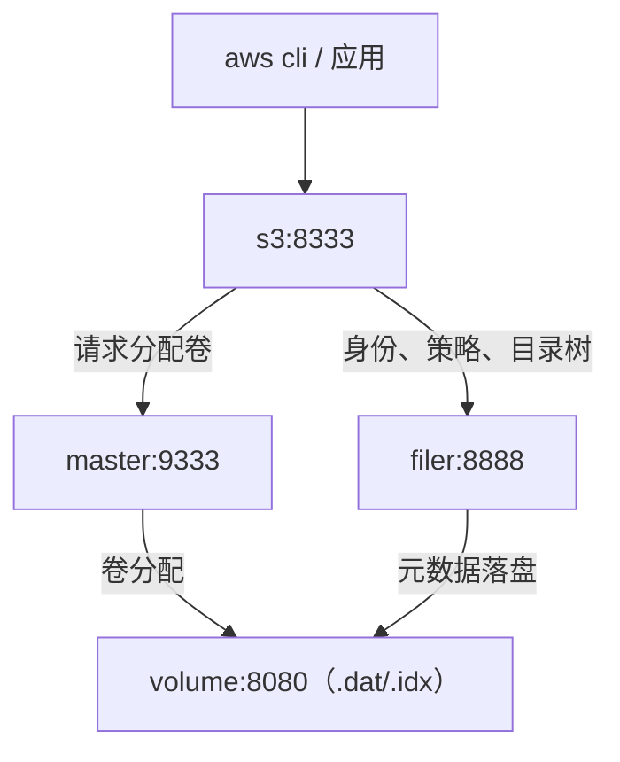

对象存储是自建服务里很容易被低估的一块。备份、网盘附件、知识库图片、CI 制品，最后都会需要一个能用 S3 协议读写的地方。MinIO 是最常见的选择，但它的强项是纠删码和成熟的控制台，单机跑一套并不算轻。SeaweedFS 走的是另一条路：Apache-2.0 许可，单个二进制，卷式追加写，S3 网关只是它众多入口中的一个。

选它的主要理由是资源占用和对海量小文件的友好程度。一台普通的小机器，跑 master、volume、filer、s3、admin 五个进程，内存占用仍然很低，也不需要为「对象存储」单独准备一块大盘。代价是它的 IAM 模型和 AWS 不完全一样，照搬 AWS 的命令很容易在第一步就卡住。这篇文章按实际跑通的顺序，把五组件拆开、把身份和策略讲清楚。

::github{repo="seaweedfs/seaweedfs"}

## 组件模型：五个进程各干什么

SeaweedFS 把「元数据」和「对象数据」彻底分开。五个进程各管一段：

| 组件 | 职责 | 关键参数 |
|---|---|---|
| master | 维护拓扑、分配卷、保存 raft 状态 | `-mdir`、`-volumeSizeLimitMB` |
| volume | 真正存对象数据，落成 `.dat` 和 `.idx` 文件 | `-dir`、`-max` |
| filer | 目录树、文件系统语义、IAM 与生命周期元数据 | `-defaultStoreDir` |
| s3 | S3 协议网关，把 HTTP 请求翻译成 filer 操作 | `-filer`、`-config` |
| admin | Web 控制台，查看拓扑、桶、用户、策略 | `-master` |

一次上传的路径大致是这样：



`master` 不存对象，只告诉客户端「这个 collection 应该去哪个 volume 写」。`volume` 按卷组织数据，一个卷有固定上限，写满后再向 master 申请新卷。`filer` 是文件系统层，S3 网关的桶、对象 key、IAM 用户、策略、生命周期规则都记在它这里。`s3` 本身几乎无状态，只读配置文件和 filer。`admin` 则通过 master 发现 filer、volume 和 s3。

单机也可以直接用 `weed server -dir=/data` 把所有组件塞进一个进程。不推荐把它当长期方案：排障时分不清是网关、filer 还是 volume 的问题，日志也混在一起。拆成五个容器后，每个组件的日志、健康检查、重启策略都能单独控制，代价只是多写几十行 compose。

## Compose 编排

下面是实际跑通的 `compose.yaml`。端口映射到宿主机，容器之间走 compose 默认网络，用服务名互相访问。

```yaml
name: sw-demo

services:
  master:
    image: chrislusf/seaweedfs:4.51
    command: master -ip=master -ip.bind=0.0.0.0 -mdir=/data -volumeSizeLimitMB=1024 -defaultReplication=000
    ports:
      - "19444:9333"
    volumes:
      - ./data/master:/data
    healthcheck:
      test: ["CMD", "curl", "-fsS", "http://127.0.0.1:9333/cluster/status"]
      interval: 10s
      timeout: 3s
      retries: 10
      start_period: 10s

  volume:
    image: chrislusf/seaweedfs:4.51
    command: volume -master=master:9333 -ip=volume -ip.bind=0.0.0.0 -dir=/data -max=32
    ports:
      - "19555:8080"
    volumes:
      - ./data/volume:/data
    depends_on:
      master:
        condition: service_healthy
    healthcheck:
      test: ["CMD", "curl", "-fsS", "http://127.0.0.1:8080/status"]
      interval: 10s
      timeout: 3s
      retries: 10
      start_period: 10s

  filer:
    image: chrislusf/seaweedfs:4.51
    command: filer -master=master:9333 -ip=filer -ip.bind=0.0.0.0 -port=8888 -defaultStoreDir=/data -defaultReplicaPlacement=000
    ports:
      - "18888:8888"
    volumes:
      - ./data/filer:/data
    depends_on:
      master:
        condition: service_healthy
      volume:
        condition: service_healthy
    healthcheck:
      test: ["CMD", "curl", "-fsS", "http://127.0.0.1:8888/"]
      interval: 10s
      timeout: 3s
      retries: 10
      start_period: 10s

  s3:
    image: chrislusf/seaweedfs:4.51
    command: s3 -filer=filer:8888 -ip.bind=0.0.0.0 -port=8333 -config=/etc/seaweedfs/s3.json
    environment:
      WEED_JWT_FILER_SIGNING_KEY: 8f3c1d9a6b2e4f7081a5c3d7e9b0f2a4
    ports:
      - "19333:8333"
    volumes:
      - ./s3.json:/etc/seaweedfs/s3.json:ro
    depends_on:
      filer:
        condition: service_healthy
    healthcheck:
      test: ["CMD", "curl", "-sS", "http://127.0.0.1:8333/"]
      interval: 10s
      timeout: 3s
      retries: 10
      start_period: 10s

  admin:
    image: chrislusf/seaweedfs:4.51
    command: admin -master=master:9333 -ip=0.0.0.0 -port=12535 -dataDir=/data -adminUser=admin -adminPassword=change-me-please
    environment:
      WEED_JWT_FILER_SIGNING_KEY: 8f3c1d9a6b2e4f7081a5c3d7e9b0f2a4
    ports:
      - "19200:12535"
    volumes:
      - ./data/admin:/data
    depends_on:
      master:
        condition: service_healthy
    healthcheck:
      test: ["CMD", "curl", "-sS", "http://127.0.0.1:12535/"]
      interval: 10s
      timeout: 3s
      retries: 10
      start_period: 10s
```

几处参数值得单独说明：

- `-ip` 是组件对外广播的地址，不是监听地址。容器里必须填服务名（`master`、`volume`、`filer`），否则 master 把 volume 注册成容器内网 IP，别的组件重启后解析不到。真正监听所有网卡靠 `-ip.bind=0.0.0.0`。
- `-volumeSizeLimitMB=1024` 把单卷上限压到 1 GB，适合演示和小数据量。默认值更大，写满后才会申请新卷，小机器上没必要一上来就占很大。
- `-max=32` 是 volume 进程允许的总卷数。这个值太小会直接卡死新桶的首次写入，后文「常见问题」会细说。一开始写 `-max=8`，volume 启动时预建了 7 个空卷，建完第二个桶就没有可写卷了。
- `-defaultReplication=000` 表示不做副本。单机没有第二块盘可放副本，写了 `001` 也只会让写入失败。
- `WEED_JWT_FILER_SIGNING_KEY` 只注入 `s3` 和 `admin`。没有它，s3 启动日志会打 `Failed to load IAM configuration: no signing key found for STS service`，动态 IAM 直接不启用；静态身份仍然可用，所以很容易误判成「配置没错，只是权限不对」。`filer` 不要注入同一个变量：按上游的说明，那会打开 filer 写入侧的 JWT 校验，平白多一层失败面。示例里的密钥是随机串，生产环境请换掉。
- admin 从 4.46 起对非 loopback 绑定要求鉴权。示例里直接写了用户名密码，生产环境请改成 `.env` 或 Docker secret，不要把密码提交进仓库。

`docker compose up -d` 之后，五个容器都应该进入 healthy：

```text
$ docker compose ps
NAME               IMAGE                      COMMAND                  SERVICE   CREATED          STATUS                        PORTS
sw-demo-admin-1    chrislusf/seaweedfs:4.51   "/entrypoint.sh admi…"   admin     54 minutes ago   Up About a minute (healthy)   0.0.0.0:19200->12535/tcp, [::]:19200->12535/tcp
sw-demo-filer-1    chrislusf/seaweedfs:4.51   "/entrypoint.sh file…"   filer     54 minutes ago   Up 58 seconds (healthy)       0.0.0.0:18888->8888/tcp, [::]:18888->8888/tcp
sw-demo-master-1   chrislusf/seaweedfs:4.51   "/entrypoint.sh mast…"   master    54 minutes ago   Up About a minute (healthy)   0.0.0.0:19444->9333/tcp, [::]:19444->9333/tcp
sw-demo-s3-1       chrislusf/seaweedfs:4.51   "/entrypoint.sh s3 -…"   s3        54 minutes ago   Up 53 seconds (healthy)       0.0.0.0:19333->8333/tcp, [::]:19333->8333/tcp
sw-demo-volume-1   chrislusf/seaweedfs:4.51   "/entrypoint.sh volu…"   volume    54 minutes ago   Up About a minute (healthy)   0.0.0.0:19555->8080/tcp, [::]:19555->8080/tcp
```

健康检查的路径不是随手写的。filer 的 `/status` 返回 404，根路径 `/` 才是 200；s3 的根路径会返回 403，admin 的根路径是 307 跳登录页。后两者刻意不加 `curl -f`，只验证端口有响应，否则容器会一直显示 unhealthy。

## S3 网关配置与静态身份

s3 网关启动时会读 `-config` 指向的 JSON。最小配置长这样：

```json
{
  "identities": [
    {
      "name": "bootstrap-admin",
      "credentials": [
        {
          "accessKey": "sw-admin-key",
          "secretKey": "change-me-please"
        }
      ],
      "actions": ["Admin", "Read", "Write", "List", "Tagging"]
    }
  ]
}
```

这里的 `actions` 是 SeaweedFS 自己的粗粒度动作组，不是 IAM 策略里的 `s3:GetObject` 那种写法。`Admin` 管 IAM 管理面，`Read`/`Write` 管对象读写，`List` 管列举，`Tagging` 管标签。给一个运维身份全部五个就够用了。

静态身份和动态 IAM 是两条独立通道。静态身份写在文件里，适合做引导账号和应急入口；动态 IAM 的用户、策略、ServiceAccount 存在 filer 里，适合发给应用。两者可以同时存在，互不影响。

改完 `s3.json` 不会自动生效。网关只在启动和收到 `SIGHUP` 时重读：

```bash
docker exec sw-demo-s3-1 kill -HUP 1
```

实测结果：往文件里加一个新身份，发送 `SIGHUP` 前用新 key 调用会返回 `InvalidAccessKeyId`，发送后立刻能列出桶。动态 IAM 不受这个动作影响，改的是静态通道才需要。

先用引导身份确认网关和 filer 都通了：

```bash
export AWS_ACCESS_KEY_ID=sw-admin-key
export AWS_SECRET_ACCESS_KEY=change-me-please
export AWS_DEFAULT_REGION=us-east-1

aws --endpoint-url http://127.0.0.1:19333 s3api list-buckets
aws --endpoint-url http://127.0.0.1:19333 s3api create-bucket --bucket demo-bucket
```

返回里 `Owner.DisplayName` 是 `bootstrap-admin`，说明签名、filer 读写、桶创建这条链路都正常。AWS CLI 对自定义 endpoint 一般会自动走 path-style；如果遇到 `SignatureDoesNotMatch` 或把桶名拼进域名，执行一次：

```bash
aws configure set default.s3.addressing_style path
```

## 建桶与 IAM

这一节是和 AWS 直觉差异最大的地方。先把结论摆出来：

1. **user 和 access key 是两层**。user 是隔离单元，策略挂在 user 上；access key（或 ServiceAccount）只是连接凭据。删 user 不会连带删 ServiceAccount，吊销身份要分别处理。
2. **新建 user 默认零权限**。不绑策略之前，它连自己名下的桶都读不到。
3. **建桶不走 S3 API**。动态 IAM 的策略动作里没有 `s3:CreateBucket`，`aws s3 mb` 会被拒；桶要用 filer 侧的 `weed shell` 建。
4. **策略是整份覆盖**。4.5x 没有 `s3.policy.create`，只能落文件再 `s3.policy -put`。

下面按这四条走一遍。下文的 shell 命令都通过 filer 容器执行：

```bash
docker exec -i sw-demo-filer-1 weed shell -master=master:9333 -filer=filer:8888
```

修改类命令要先 `lock`，重复执行没有副作用。先建一个带 owner 的桶，再建一个应用用户：

```bash
printf 'lock\ns3.bucket.create -name app-data -owner demo-app\ns3.user.create -name demo-app\n' | docker exec -i sw-demo-filer-1 weed shell -master=master:9333 -filer=filer:8888
```

`-owner` 不能省。它决定这个桶归哪个 IAM user，之后该 user 的 `list-buckets` 只会看到自己名下的桶。`s3.user.create` 会打印一把默认 access key 和 secret，secret 只出现一次。这把 key 属于 user 本身，应用通常不用它，建完 ServiceAccount 后可以删掉。

新 user 建出来是空策略。用它上传会直接拿到 `AccessDenied`，这是预期，不是配置坏了。接下来写策略文件：

```json
{
  "Version": "2012-10-17",
  "Statement": [
    {
      "Effect": "Allow",
      "Action": [
        "s3:GetObject",
        "s3:PutObject",
        "s3:DeleteObject",
        "s3:ListBucket",
        "s3:AbortMultipartUpload",
        "s3:ListMultipartUploadParts"
      ],
      "Resource": [
        "arn:aws:s3:::app-data",
        "arn:aws:s3:::app-data/*"
      ]
    }
  ]
}
```

`Resource` 要写两条：桶本身供 `ListBucket`，`桶/*` 供对象操作。只写对象级 ARN 时，列举桶内对象会失败，这个坑和 AWS 一样。

把文件拷进容器，然后 `-put`、`-attach`：

```bash
docker cp pol-demo-app.json sw-demo-filer-1:/tmp/pol-demo-app.json

printf 'lock\ns3.policy -put -name=pol-demo-app -file=/tmp/pol-demo-app.json\ns3.policy.attach -user demo-app -policy pol-demo-app\n' | docker exec -i sw-demo-filer-1 weed shell -master=master:9333 -filer=filer:8888
```

这里有两个实测确认的细节。第一，`s3.policy.create` 不存在，执行会直接报 `unknown command: s3.policy.create`；第二，`s3.policy -put` 是整份覆盖，不是合并。用一份只含 `s3:GetObject` 的策略覆盖同名策略，`s3.policy -get` 读回来就只剩这一条，原来的动作全没了。所以更新策略时要拿完整文件去覆盖，不能只写增量。


应用侧不建议直接用 user 的默认 key。建一个 ServiceAccount：

```bash
printf 'lock\ns3.serviceaccount.create -user demo-app -description "demo app runtime"\n' | docker exec -i sw-demo-filer-1 weed shell -master=master:9333 -filer=filer:8888
```

输出里有 `sa:demo-app:<随机串>`、Access Key 和 Secret Key，secret 同样只显示一次。之后用它跑完整的读写删：

```bash
export AWS_ACCESS_KEY_ID=<service-account-access-key>
export AWS_SECRET_ACCESS_KEY=<service-account-secret>

aws --endpoint-url http://127.0.0.1:19333 s3 cp ./hello.txt s3://app-data/hello.txt
aws --endpoint-url http://127.0.0.1:19333 s3 ls s3://app-data/
aws --endpoint-url http://127.0.0.1:19333 s3 cp s3://app-data/hello.txt -
aws --endpoint-url http://127.0.0.1:19333 s3 rm s3://app-data/hello.txt
```

```text
$ aws --endpoint-url http://127.0.0.1:19333 s3 cp ./hello.txt s3://app-data/hello.txt
upload: ./hello.txt to s3://app-data/hello.txt
$ aws --endpoint-url http://127.0.0.1:19333 s3 ls s3://app-data/
2026-11-02 13:13:53         26 hello.txt
$ aws --endpoint-url http://127.0.0.1:19333 s3 cp s3://app-data/hello.txt -
hello from seaweedfs demo
$ aws --endpoint-url http://127.0.0.1:19333 s3 rm s3://app-data/hello.txt
delete: s3://app-data/hello.txt
```

再确认隔离：同一个 key 执行 `list-buckets`，只应看到 `app-data`；用引导身份则能看到 `app-data` 和 `demo-bucket`。如果应用侧能看到别人的桶，先检查桶的 owner 和策略的 `Resource`，而不是去改网关。


两个容易忽略的运维细节：

- `s3:Admin` 只覆盖 IAM 管理面（建 user、策略、ServiceAccount），**不包含** `GetObject`/`PutObject`。只给 `Admin` 的身份读不到对象，这是策略问题，不是配置问题。
- 网关的 IAM 写接口默认只读。直接用 `aws iam create-user` 会返回 `AccessDenied: IAM write operations are disabled on this server`。所有写操作走 `weed shell`，不要在这条路上浪费时间。

删身份时记得两层都处理。用一个临时 user 验证过：`s3.user.delete` 之后，它名下的 ServiceAccount 仍然出现在 `s3.serviceaccount.list` 里，只是父 user 不存在了；要用 `s3.serviceaccount.delete -id=sa:<user>:<随机串>` 单独清掉。反过来，删 ServiceAccount 也不会影响 user。

## 生命周期与版本控制

生命周期规则通过 S3 API 管理，不需要改配置文件：

```bash
aws --endpoint-url http://127.0.0.1:19333 s3api put-bucket-lifecycle-configuration \
  --bucket app-data \
  --lifecycle-configuration '{
    "Rules": [
      {
        "ID": "abort-incomplete-7d",
        "Status": "Enabled",
        "Filter": {"Prefix": ""},
        "AbortIncompleteMultipartUpload": {"DaysAfterInitiation": 7}
      }
    ]
  }'

aws --endpoint-url http://127.0.0.1:19333 s3api get-bucket-lifecycle-configuration --bucket app-data
```

回读能拿到同一条规则，说明规则已经落在桶上。`AbortIncompleteMultipartUpload` 是唯一建议默认开启的规则：未完成的分片上传不会出现在 `s3 ls` 里，但分片数据已经写进卷，长期堆着会白占空间。7 天是个保守值，给断点续传和慢速上传留足余量。

不想等生命周期扫描，也可以手动清：

```bash
printf 'lock\ns3.clean.uploads -timeAgo=24h\n' | docker exec -i sw-demo-filer-1 weed shell -master=master:9333 -filer=filer:8888
```

它会列出并 purge 超过指定时间的未完成上传目录。用 `-timeAgo=0m` 强制清过一个刚创建的分片上传，`list-multipart-uploads` 随后返回空，说明这条路径是通的。生产上把 `-timeAgo=24h` 放进每日 cron 即可，不要用 0。

需要说明的是，生命周期的**实际删除**是服务端按天执行的任务，不是分钟级。验证过规则的写入、回读和手动清理，没有等一天去观察过期对象被自动删掉；如果你要验证，建议用一个短前缀、可丢弃的对象，并预留至少一个扫描周期。

版本控制这边，4.51 的基础行为是正常的：

```bash
printf 'lock\ns3.bucket.versioning -enable -name app-data\n' | docker exec -i sw-demo-filer-1 weed shell -master=master:9333 -filer=filer:8888
```

连续写入同一个 key 两次，`list-object-versions` 能看到两个版本；不指定 version-id 删除会生成 DeleteMarker；`-suspend` 只能暂停，不能回到「从未开启」的状态，这一点和 AWS 一致。

但不建议给通用桶开版本。在 4.51 上用 20 MB 对象做了一次分片上传，`.uploads` 为空、下载 md5 一致、卷目录从 6 MB 长到 27 MB，没有看到残留或卷占用放大；但这只是一个简单场景，不能证明重写型负载下也正常。SeaweedFS 的版本回收路径仍然不如 AWS 成熟。要用的话，只对确实需要保留历史的桶开启，同时配一条过期删除规则，并定期看 `s3.bucket.list` 的 `size` 字段。普通备份和附件场景，更愿意把版本控制关掉，用外部备份解决误删。

## 数据落在哪、怎么备份

单机部署下，需要备份的是四个目录：

| 宿主机路径 | 内容 | 丢失后果 |
|---|---|---|
| `./data/master` | raft 状态、卷分配记录 | master 起不来或拓扑错乱 |
| `./data/volume` | `.dat`/`.idx`，真正的对象数据 | 对象丢失 |
| `./data/filer` | 目录树、桶元数据、IAM、生命周期 | 数据还在卷里，但没有命名空间指向它们 |
| `./data/admin` | 控制台配置、维护任务状态 | 控制台需要重新配置 |

`master` 和 `filer` 的元数据是两套东西，不能只备份其中一个。只恢复 volume、不恢复 filer，卷文件还在，但桶和对象 key 的对应关系没了；只恢复 filer、不恢复 volume，桶能列出来，读对象会失败。稳妥的做法是停掉写入（`docker compose stop s3 admin`），对 `./data` 整体做一次文件系统快照或 `restic`/`borg` 备份，再启动。恢复时四个目录一起回到同一个时间点，不要混用不同日期的备份。

`-defaultReplication=000` 意味着没有任何副本。单块盘坏了就是数据没了，备份必须落在另一块盘或另一台机器上。这一点不要因为「S3 听起来很可靠」而忽略：协议兼容不等于存储有冗余。

## 常见问题

**新建 user 上传仍然 AccessDenied。** 先看 `s3.user.show -name <user>` 的 `policies` 是否为空，再 `s3.policy -list` 确认策略存在。新建 user 默认零权限，`s3.user.create` 成功不代表能读写。

**首次写入报 `InternalError`，日志里是 `no writable volumes`。** volume 的 `-max` 用完了。volume 启动时会预建一批空卷，master 也会在后台按 collection 补卷；`-max=8` 时启动就占掉 7 个，建第二个桶后没有余量。把 `-max` 调大并重启 volume，再重试；如果调大后仍然没有可写卷，检查 volume 是否真的注册到了 master。

**执行 `s3.policy.create` 报 unknown command。** 4.5x 已经删掉这个命令。用 `s3.policy -put -name=... -file=...`，并且记住是整份覆盖。不同小版本的 shell 命令会增删，拿不准时先 `help | grep s3.` 枚举，不要凭记忆拼。

**改了 `s3.json` 但新身份不生效。** 网关只在启动和 `SIGHUP` 时重读。`docker exec sw-demo-s3-1 kill -HUP 1` 之后再试。动态 IAM 的用户和策略不受影响。

**重启后桶和用户都没了。** 九成是 bind mount 路径不对。`docker compose config` 看最终挂载，确认 `./data/*` 落在 compose 文件所在目录，而不是容器内的匿名卷。用 `docker compose down` 而不是 `down -v`，后者会连命名卷一起删。

**`s3.config.show` 显示 Policies: 0，但策略明明存在。** 这个摘要的计数不可靠，以 `s3.policy -list` 为准。同理，排查身份时不要只看摘要，`s3.user.show` 和 `s3.iam.export` 更直接。

**AWS CLI 报签名错误或连接被拒。** 先确认 `--endpoint-url` 指向 `http://127.0.0.1:19333`，region 随便填 `us-east-1` 即可；再设置 path-style。SeaweedFS 默认不启用 virtual-host 风格，桶名不会被拼进域名。

## 小结

SeaweedFS 适合这样的场景：一台或几台机器，数据量在几十 GB 到几 TB，写入以中小对象为主，想要一个 Apache-2.0、资源占用低、能说 S3 的对象存储。它的 filer 还额外提供文件系统语义，后面接网盘或知识库都比较顺。

不适合的场景也很明确：需要开箱即用的多副本、跨机架容灾、成熟的生命周期和版本管理，或者团队里没人愿意维护存储。单机 `000` 没有冗余，所有「高可用」都要自己往上叠。SeaweedFS 的 shell 命令在不同小版本之间有变化，部署时把镜像 tag 固定住，升级前先在一套测试实例上把 `s3.*` 命令枚举一遍，比事后排查便宜得多。
